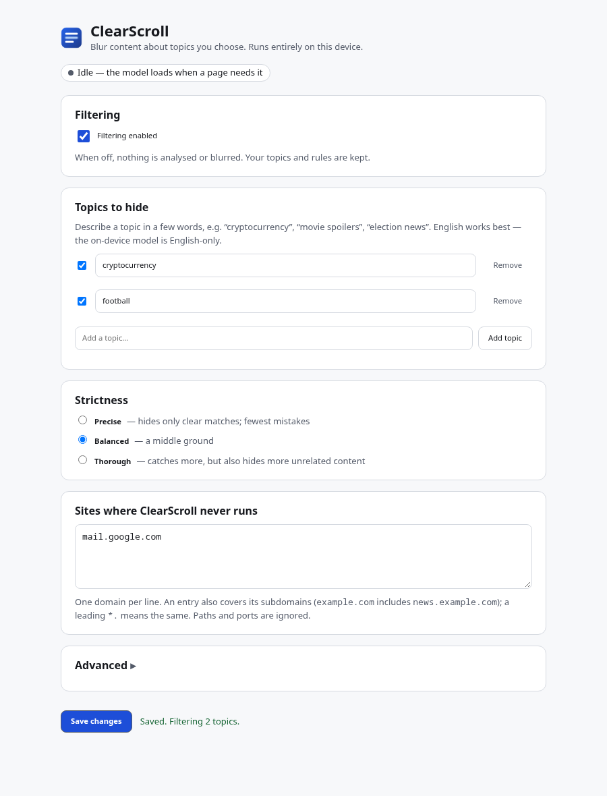
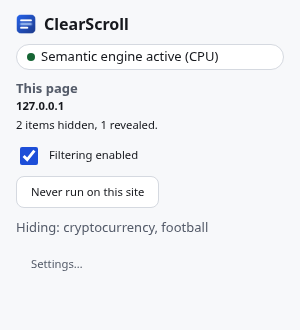
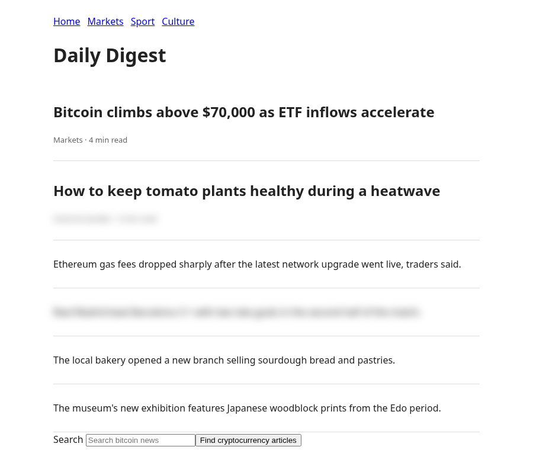
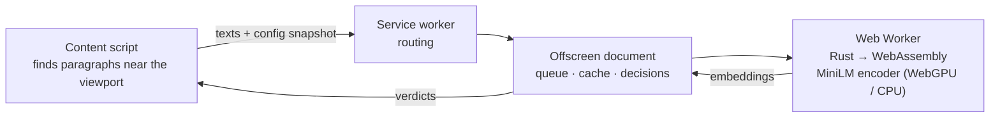
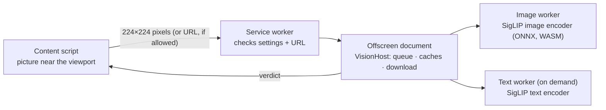

# ClearScroll

**Hide posts and articles about topics you choose — using an AI model that
runs entirely in your browser.**

ClearScroll is a Chrome extension that blurs web content semantically related
to topics such as "cryptocurrency", "football" or "election news". A
sentence-embedding model written in Rust and compiled to WebAssembly runs in
a background worker on your machine (on the GPU via WebGPU when available);
page text is never sent anywhere. Optionally (off by default, experimental)
an on-device image model also looks at the **pixels of pictures** and blurs
photos that show a topic even when they have no caption.


> **Status:** release candidate `0.3.0` on the `feat/clearscroll-0.3` branch,
> not yet merged into `main` (which still holds the earlier IdeaBlocker
> version). Buildable and tested locally; CI runs on every push to the
> branch. Not published on the Chrome Web Store. English only (see
> [limitations](#limitations)).

## Features

* **Semantic topics** — in balanced mode "football" also catches "Messi
  scores twice in the final", which never mentions the word; several topics
  can be active at once and toggled individually.
* **Three strictness levels** with thresholds calibrated on a labelled
  dataset (not guessed).
* **Whole items, not just text** — a matching video card, post or news promo
  is hidden together with its thumbnail and metadata
  ([before](docs/images/7-feeds-unfiltered.png) /
  [after](docs/images/8-feeds-filtered.png), topic "football").
* **Pictures, from their pixels (opt-in, experimental)** — with *Images* on,
  a local SigLIP image–text model blurs a cat photo for "cats" or a match
  photo for "football" with no caption, alt text or nearby text; a dog photo
  or a rugby scrum stays visible. Measured on held-out photos: precision
  93 %, recall 80 % ([results](docs/evaluation/vision/RESULTS.md)).
* **Reveal on click or Enter** for any single item; filtering continues.
* **Per-site control** from the toolbar popup; site rules with validation.
* **Honest status** — shows whether the semantic engine runs on WebGPU or
  CPU, or whether only keyword matching is available, and why.
* **Private by construction** — no server, no telemetry; verified by an
  automated network-capture test.

| Settings | Popup | Revealed item |
|---|---|---|
|  |  |  |

## How it works



1. The content script groups page text into paragraph-sized **units** and
   sends the ones near the viewport, in small batches, together with an
   immutable snapshot of the current settings.
2. In an offscreen document, the engine embeds texts and topics with
   [all-MiniLM-L6-v2](https://huggingface.co/sentence-transformers/all-MiniLM-L6-v2)
   (mean pooling, L2 norm) and compares them by cosine similarity against a
   per-model, per-mode threshold; keyword rules complement it.
3. The content script applies a verdict only if the settings, the element
   and its text are still the same, by toggling an extension-owned attribute
   styled with `filter: blur()` — page markup and styles are left untouched.
   When the text belongs to a feed item with a picture (a video card, a news
   promo), the whole item is hidden, thumbnail and metadata included.

**Images (opt-in).** A separate pipeline: the content script reads the
pixels of pictures near the viewport (or, for other-domain pictures and only
if the user allows it, sends their URL), the offscreen document runs a
quantised [SigLIP](https://huggingface.co/google/siglip-base-patch16-224)
image encoder with ONNX Runtime Web (WebAssembly, CPU) in its own worker, and
compares the picture with the topic and with generic "something else"
descriptions. Text filtering never waits for it.



Details: [docs/ARCHITECTURE.md](docs/ARCHITECTURE.md) ·
design rationale: [docs/ENGINEERING_DECISIONS.md](docs/ENGINEERING_DECISIONS.md)

## Results

**Quality** — English, held-out test split of 356 labelled texts including
38 UI strings (navigation, metadata, ads), balanced mode
([full report](docs/evaluation/RESULTS.md), [method](docs/MODEL.md#evaluation)):

| Classifier | Precision | Recall | F1 | False-positive rate | FPR on UI strings |
|---|---|---|---|---|---|
| ClearScroll (MiniLM-L6, margin scoring + sibling veto + keywords) | 69.1 % | 57.1 % | 62.5 % | 2.5 % | 1.5 % |
| Same, without the sibling veto (until Task 06) | 66.1 % | 61.4 % | 63.7 % | 3.0 % | 1.8 % |
| Same model, plain cosine similarity | 52.0 % | 56.5 % | 54.2 % | 5.0 % | 17.6 % |
| Keywords only | 50.0 % | 1.1 % | 2.1 % | 0.1 % | — |
| Previous model (bert-tiny), calibrated | 23.9 % | 55.4 % | 33.4 % | 17.0 % | 29.4 % |

Texts are scored by how much more they resemble your topic than a set of
unrelated background topics; this removes most false positives on page
furniture at a small cost on clean content (trade-off in
[docs/MODEL.md](docs/MODEL.md#margin-scoring-against-background-topics)).
A text is also not matched when it is clearly closer to a *sibling* of your
topic — rugby or basketball for "football", dogs for "cats", gold or stocks
for "cryptocurrency" ([sibling veto](docs/MODEL.md#sibling-veto-task-07)).
This synthetic set has few such neighbours; the real-world pages below
show the effect.
The Rust engine reproduces the Hugging Face reference implementation:
0/24 token-id mismatches, max embedding difference 3 × 10⁻⁷.

**On real pages** — text units captured with the extension from public
pages and labelled by hand (9,041 in five splits; the texts themselves are
kept private, [method](eval/realworld/README.md)). Latest held-out split
(Task 07): 2,681 English texts from 22 new pages and 7 topics — 3 of them
never used in development — captured and labelled after the method and the
acceptance criteria were
[pre-registered](docs/evaluation/realworld/PREREGISTRATION-task07.md),
balanced mode ([report](docs/evaluation/realworld/RESULTS.md); before:
[without the sibling veto](docs/evaluation/realworld/RESULTS-no-siblings.md)):

| Topic | Precision | Recall | False-positive rate |
|---|---|---|---|
| cats | 44.0 → 84.0 % | 90.3 → 90.3 % | 34.2 → 5.1 % |
| dogs *(unseen)* | 47.5 → 92.3 % | 92.4 → 91.3 % | 31.4 → 2.3 % |
| football | 58.6 → 76.7 % | 89.1 → 85.9 % | 17.7 → 7.3 % |
| basketball *(unseen)* | 50.7 → 90.4 % | 87.4 → 86.2 % | 23.3 → 2.5 % |
| cryptocurrency | 37.5 → 93.3 % | 44.2 → 44.2 % | 23.2 → 1.0 % |
| stock market *(unseen)* | 32.9 → 61.8 % | 94.3 → 88.7 % | 31.7 → 9.0 % |
| movie spoilers | 37.7 → 72.3 % | 96.8 → 96.8 % | 43.6 → 10.1 % |
| **all texts** | **44.2 → 81.1 %** | **83.4 → 82.1 %** | **28.7 → 5.2 %** |
| hidden cards | 43.9 → 79.3 % | 89.2 → 87.3 % | 33.0 → 6.6 % |

604 false positives became 110 for 8 lost matches. On a page of puppy
videos "cats" now hides 12 % of the texts instead of 70 %, "basketball" 5 %
instead of 58 % of Champions League goals, "movie spoilers" 14 % instead of
72 % of trailers. What remains: mixed texts ("Gold and silver prices seesaw
as FTSE 100 hits record high" is no longer hidden for "stock market"),
tennis for "football" (22 %), and the model's limited knowledge of coin
names (cryptocurrency recall 29 % on a page of Solana videos, unchanged).
Earlier attempt with a flat taxonomy of 106 subjects: false positives
8.7 %, recall 62.8 %, **not shipped**
([details](docs/MODEL.md#reducing-false-positives-task-04)).

**Pictures** — SigLIP base/16 (int8), from pixels only, 10 topics, 223
held-out Wikimedia Commons photos, default (precise) strictness
([report](docs/evaluation/vision/RESULTS.md), pre-registered before scoring):

| | Precision | Recall | F1 | False-positive rate |
|---|---|---|---|---|
| all ten topics | 93.1 % | 80.3 % | 86.2 % | 0.4 % |
| cats / dogs / fast food / cryptocurrency | 100 % | 100 / 75 / 94 / 92 % | | 0 % |
| football (vs rugby, basketball) | 77 % | 77 % | | 1.6 % — 3 of 24 rugby/basketball photos hidden |
| politics | 60 % | 38 % | | abstract; rarely visible in a photo |

Per picture ≈ 0.17 s with 4 CPU threads (Intel i7-11800H; 0.56 s on one
thread — fewer cores, fewer threads); first picture ≈ 1.9 s after turning
images on; +0.36 GiB memory while active, ~+0.9 GiB for a few seconds when a
new topic is embedded, released after 5 minutes without pictures ([benchmarks](docs/BENCHMARKS.md#image-filtering)).

## Install (from source)

Requirements: Node.js ≥ 22.18, Rust via [rustup](https://rustup.rs) (the
pinned toolchain installs automatically), Python 3.13 (or [uv](https://docs.astral.sh/uv/)),
and `wasm-bindgen-cli` matching `Cargo.lock`.

Version 0.3 is on the `feat/clearscroll-0.3` branch; a plain clone checks out
`main`, which still contains the earlier IdeaBlocker version and does not
have these build steps. Clone the branch explicitly:

```bash
git clone --branch feat/clearscroll-0.3 https://github.com/ozankenangungor/ClearScroll.git && cd ClearScroll
cargo install wasm-bindgen-cli --version 0.2.129 --locked
npm ci
npm run setup:model   # pinned model download + export + sha256 verification
npm run setup:vision  # pinned image model download + sha256 (the build also does this)
npm run build         # → dist/
npm run validate
```

Then open `chrome://extensions`, enable *Developer mode*, choose *Load
unpacked* and select `dist/`. Open the extension's settings, add a topic and
browse. Chrome 116 or newer is required.

## Testing

```bash
npm run check                     # typecheck, 113 unit tests, Rust tests
npx playwright install chromium
npm run test:dom                  # 51 content-script tests in real Chromium (18 for images)
npm run test:e2e                  # 38 end-to-end + accessibility (axe-core) tests, 12 with the real image model
CLEARSCROLL_BROWSER=chrome npm run test:e2e   # the same on Google Chrome stable
npm run verify:privacy            # network capture: no requests from the extension
npm run verify:privacy:images     # the same with image filtering on (and with downloads on)
npm run evaluate                  # semantic quality report
npm run evaluate:vision -- --manifest <dir>/manifest.json --set val   # image quality (private photo set)
npm run benchmark:vision          # image-filtering latency, memory, text impact
```

CI ([.github/workflows/ci.yml](.github/workflows/ci.yml)) runs all of the
above plus formatting, Clippy for native and wasm32, dependency licence and
advisory checks, model-artifact verification, Rust/PyTorch parity (f16 and
f32), quality gates (English F1 ≥ 60 %, false positives on UI strings ≤ 5 %)
and the end-to-end/privacy suites on Chromium and on Google Chrome stable,
including the image model (pinned download and sha256, tokenizer and encoder
parity, real-model browser tests, image privacy checks).

## Privacy and security

* All processing is local; settings are stored in `chrome.storage.local`.
* Network: none with default settings and none with image filtering on. Only
  if you also enable *Also check pictures from other domains* does
  ClearScroll download a second copy of pictures the page displays from
  other domains (no cookies, no referrer, size/type/time limits, no private
  network addresses) — see [docs/PRIVACY.md](docs/PRIVACY.md).
* Permissions: host access to http/https pages, `scripting`, `storage`,
  `offscreen` — each justified in [docs/PRIVACY.md](docs/PRIVACY.md).
* No `web_accessible_resources`, no remote code, CSP
  `script-src 'self' 'wasm-unsafe-eval'`; all messages are validated.
* The models ship inside the package; there are no run-time model downloads.

## Limitations

* **English only.** All bundled encoders use an English vocabulary; on
  Turkish text ranking quality is at chance level (ROC-AUC ≈ 0.53).
  Keyword rules still work in any language.
* **Neighbouring subjects are only partly separated.** The sibling veto
  knows six domains (sports, animals, finance, film and TV, technology,
  music). Inside them most confusions are gone, but texts about two
  siblings at once can be missed, and a neighbouring sport with no word in
  common can still slip through (tennis for "football": 22 % of a tennis
  page). Topics outside those domains (politics, people, places, hobbies)
  behave as before — for them the model separates broad domains, not close
  ones. Because whole items are hidden, each mistake hides a whole card.
* **Topics are matched by what a text is about, not what it does.** Requests
  that need interpretation — "spoilers" (what a text reveals), "negative
  reviews", "clickbait" — are not detected as such: "movie spoilers" hides
  film and TV content in general, including trailers and reviews that say
  they are spoiler-free. Any topic can still be entered.
* **Imperfect recall.** About 40 % of related texts are missed on the
  synthetic set at balanced strictness and about 20 % on captured real pages
  (use *Thorough* for more recall); short labels such as channel names or
  "Premier League" match by keywords only. A text
  that mixes your topic with another subject can be missed ("Dogecoin …
  posted a picture of a Shiba Inu" looks more like *pets* than *crypto* to
  the model). Broad topics ("sports") work worse than concrete ones
  ("football").
* Text rendered inside **shadow roots** (light-DOM text slotted into
  components is analysed) and **iframes** is not analysed.
* Content is visible briefly until it is classified: on live pages (YouTube,
  BBC Sport; CPU backend) about 0.2–0.7 s while the engine runs and
  1.1–1.7 s on the first page after it starts (`scripts/live-latency.ts`).
* The unpacked package is ~273 MiB: ~217 MiB image model and runtime (always
  shipped, loaded only when image filtering is on) and ~55 MiB text engine,
  mostly weights (half-precision); lighter
  MiniLM-L3 (45 MiB) and bert-tiny (20 MiB) builds are available
  (`CLEARSCROLL_MODEL=…`) with lower quality.
* WebAssembly memory is ~220 MiB on the CPU backend (~100 MiB with WebGPU).

### Image filtering

* **Off by default and experimental.** Concrete subjects (animals, vehicles,
  food, coins, many sports) work well; abstract ones (politics, "news") are
  rarely recognisable from a picture alone, and similar-looking subjects are
  confused (football vs rugby, especially in *Thorough* mode where precision
  drops to 80 %, 46 % for football).
* **Coverage:** `` (incl. `<picture>`/`srcset`), `<video poster>` and
  CSS background pictures on content elements, at least 100 × 80 px. Not:
  icons and avatars, SVG, `<canvas>`, video frames, pictures in iframes or
  shadow roots. Pictures from other domains (most large sites) are only
  analysed with the download option on; otherwise they are left visible and
  counted in the popup. Same-origin video posters and CSS backgrounds also
  need that option (only `data:`/`blob:` ones are read in the page).
  Downloads never follow redirects (pictures served through a redirect are
  left unchecked), and the address check cannot detect a public name that
  resolves to a private address (DNS rebinding).
* **Cost:** ≈ 0.17 s per new picture on a 16-thread laptop (up to 4 CPU
  threads; ≈ 0.6 s on one), pictures appear unblurred until analysed, +217
  MiB package size (≈ 273 MiB unpacked in total) and ≈ 0.36 GiB extra memory
  while active (~0.9 GiB briefly while a new topic is embedded; the model is
  unloaded after 5 minutes without pictures and reloads in ≈ 0.9 s).

## Troubleshooting

| Problem | Fix |
|---|---|
| Status says "Keyword matching only" | Settings → Advanced → Diagnostics shows the reason; try *Inference engine: CPU only*. |
| Nothing is blurred | Check that filtering is enabled and a topic is active; reload tabs opened before installing. |
| Part of a site breaks | Add the area to *Protected areas* (CSS selector) or exclude the site from the popup. |
| Build: `wasm-bindgen CLI … requires …` | Install the exact version printed. |
| Build: sha256 mismatch | `rm -rf build/models && npm run setup:model`. |

More in [docs/PRODUCTION_RUNBOOK.md](docs/PRODUCTION_RUNBOOK.md).

## Project structure

```
src/shared/      settings, site rules, protocol, classifier, model profiles
src/content/     content script (controller, DOM helpers, CSS)
src/background/  service worker
src/offscreen/   offscreen document, engine host (queue, cache, fail-over), vision host
src/engine/      Web Worker around the WASM module
src/vision/      image-model worker (ONNX Runtime Web), SigLIP tokenizer, preprocessing
src/*.rs         Rust engine: weights, tokenizer, BERT encoder, WASM bindings
tools/           model export and reference parity (Python)
scripts/         build, validation, evaluation, benchmarks, privacy check
tests/           unit, DOM, end-to-end, Rust parity, fixtures
eval/            labelled evaluation dataset
docs/            architecture, model card, benchmarks, privacy, runbook
```

## Roadmap

* Optional host permissions / per-site activation.
* Reduce WebAssembly memory on the CPU backend (allocator / streaming load).
* Shadow DOM and same-origin iframe support.
* A multilingual model; a larger, multi-annotator evaluation set.

## Contributing

See [CONTRIBUTING.md](CONTRIBUTING.md). Bug reports with a page that
reproduces the issue are very welcome.

## License and attribution

ClearScroll is licensed under the [ISC License](LICENSE). It bundles the
weights of `sentence-transformers/all-MiniLM-L6-v2` (Apache-2.0), the
SigLIP image and text encoders of `google/siglip-base-patch16-224`
(Apache-2.0, int8 ONNX export) and ONNX Runtime Web (MIT), and compiles Rust
crates under permissive licences; see
[THIRD_PARTY_NOTICES.md](THIRD_PARTY_NOTICES.md).
