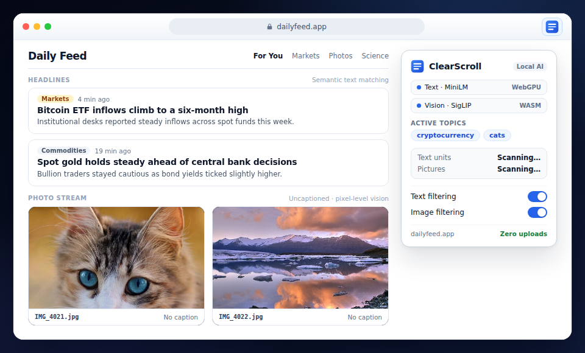

<p align="center">
  
</p>

<h1 align="center">ClearScroll</h1>

<p align="center">
  A Chrome extension that blurs webpage text and images about topics you'd rather skip — powered by local LLM &amp; vision models running right in your browser.
</p>

<p align="center">
  <a href="#build-and-load-in-chrome">Install</a> ·
  <a href="#how-it-works">How it works</a> ·
  <a href="#what-to-expect">Privacy &amp; limits</a> ·
  <a href="#development">Development</a>
</p>

<p align="center">
  
</p>

Keyword blockers miss posts that never mention your exact word, and sending every page you read to a remote API isn't a trade-off worth making. ClearScroll runs an [`all-MiniLM-L6-v2`](https://huggingface.co/sentence-transformers/all-MiniLM-L6-v2) sentence encoder directly inside Chrome using Rust and WebAssembly (WebGPU when available, SIMD CPU fallback otherwise) — plus an optional on-device [SigLIP](https://huggingface.co/google/siglip-base-patch16-224) image filter that checks uncaptioned pictures from their pixels. Page content never leaves your device.

## What you can do with it

- Add one or more topics in plain English (like `cryptocurrency` or `cats`) and toggle each one independently.
- Choose between *Precise*, *Balanced*, and *Thorough* strictness, or add per-topic literal exclusions (for example, exclude `NFL` under `football`).
- When text inside a feed card or news promo matches, the whole card blurs together with its thumbnail.
- In full builds (`--with-images`), turn on local image filtering to blur matching photos even without captions or alt text.
- Click any blurred item — or focus it and press `Enter` or `Space` — to reveal it without following nested links on the first click.
- Pause filtering globally or exclude the current site straight from the toolbar popup.

## Build and load in Chrome

You'll need Chrome 116+, Node.js 22.18+, the Rust toolchain pinned in [`rust-toolchain.toml`](rust-toolchain.toml), `wasm-bindgen-cli` matching [`Cargo.lock`](Cargo.lock), and Python 3.13 for the one-time model export.

```sh
npm ci
npm run setup:model   # downloads and verifies the pinned MiniLM weights
npm run build         # builds the Rust/WASM engine and bundles dist/
```

Then load the unpacked extension:

1. Open `chrome://extensions` and turn on **Developer mode**.
2. Click **Load unpacked** and select `dist/`.
3. Settings opens on first install — add a topic, pick a strictness level, and click **Save changes**.

The default build is text-focused (~55 MiB). If you want to test the experimental on-device image filter (SigLIP via ONNX Runtime Web), build with `node scripts/build.mjs --with-images`.

## How it works

The content script groups visible page text into paragraph-sized units near the viewport and sends small batches to an offscreen document running the Rust/WASM encoder in a dedicated Web Worker. Running inference in an offscreen document keeps all tabs sharing one loaded model and avoids strict page CSPs.

Rather than relying on raw cosine similarity — which tends to blur navigation menus and page metadata — ClearScroll scores each paragraph by its margin over a set of generic background topics, then applies a sibling veto to cut down false positives on neighbouring subjects (such as rugby for `football` or dogs for `cats`). Verdicts are applied with a reversible `data-clearscroll` attribute so existing page styles stay intact.

## What to expect

- Filtering is best-effort: some matching items will get through and unrelated text can occasionally blur. It isn't meant to be a guaranteed spoiler blocker or parental-control tool.
- The bundled model is English-only; other languages fall back to literal word and phrase matching.
- Text can appear briefly before a batch finishes checking, especially on a cold start.
- YouTube video/Shorts hover previews can escape blurring, so fresh installs exclude `youtube.com` and `youtu.be` by default (editable in Settings). Chrome internal pages, the Web Store, PDFs, and embedded frames aren't filtered.
- No accounts, telemetry, or runtime network requests. Settings and optional mistake reports stay in Chrome's local extension storage and can be exported or deleted in Settings.

## Development

```sh
npm run check          # TypeScript typecheck, unit tests, and Rust tests
npm run build
npm run validate       # checks manifest, CSP, assets, and model hashes in dist/
npm run test:dom       # DOM controller tests in Chromium
npm run test:e2e:text  # end-to-end and accessibility tests
npm run verify:privacy # differential network-capture check (zero egress)
```

Licensed under [ISC](LICENSE). Bundled model and crate attributions are in [THIRD_PARTY_NOTICES.md](THIRD_PARTY_NOTICES.md).
