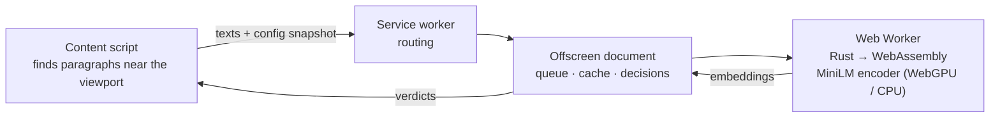

# ClearScroll

**Hide posts and articles about topics you choose — using an AI model that
runs entirely in your browser.**

ClearScroll is a Chrome extension that blurs web content semantically related
to topics such as "cryptocurrency", "movie spoilers" or "election news". A
sentence-embedding model written in Rust and compiled to WebAssembly runs in
a background worker on your machine (on the GPU via WebGPU when available);
page text is never sent anywhere.


> **Status:** release candidate `0.3.0`, buildable and tested locally and in
> CI. Not published on the Chrome Web Store. English only (see
> [limitations](#limitations)).

## Features

* **Semantic topics** — in balanced mode "football" also catches "Messi
  scores twice in the final", which never mentions the word; several topics
  can be active at once and toggled individually.
* **Three strictness levels** with thresholds calibrated on a labelled
  dataset (not guessed).
* **Reveal on click or Enter** for any single item; filtering continues.
* **Per-site control** from the toolbar popup; site rules with validation.
* **Honest status** — shows whether the semantic engine runs on WebGPU or
  CPU, or whether only keyword matching is available, and why.
* **Private by construction** — no server, no telemetry; verified by an
  automated network-capture test.

| Settings | Popup | Revealed item |
|---|---|---|
|  |  |  |

## How it works



1. The content script groups page text into paragraph-sized **units** and
   sends the ones near the viewport, in small batches, together with an
   immutable snapshot of the current settings.
2. In an offscreen document, the engine embeds texts and topics with
   [all-MiniLM-L6-v2](https://huggingface.co/sentence-transformers/all-MiniLM-L6-v2)
   (mean pooling, L2 norm) and compares them by cosine similarity against a
   per-model, per-mode threshold; keyword rules complement it.
3. The content script applies a verdict only if the settings, the element
   and its text are still the same, by toggling an extension-owned attribute
   styled with `filter: blur()` — page markup and styles are left untouched.

Details: [docs/ARCHITECTURE.md](docs/ARCHITECTURE.md) ·
design rationale: [docs/ENGINEERING_DECISIONS.md](docs/ENGINEERING_DECISIONS.md)

## Results

**Quality** — English, held-out test split of 356 labelled texts including
38 UI strings (navigation, metadata, ads), balanced mode
([full report](docs/evaluation/RESULTS.md), [method](docs/MODEL.md#evaluation)):

| Classifier | Precision | Recall | F1 | False-positive rate | FPR on UI strings |
|---|---|---|---|---|---|
| ClearScroll (MiniLM-L6, margin scoring + keywords) | 66.1 % | 61.4 % | 63.7 % | 3.0 % | 1.8 % |
| Same model, plain cosine similarity | 52.0 % | 56.5 % | 54.2 % | 5.0 % | 17.6 % |
| Keywords only | 50.0 % | 1.1 % | 2.1 % | 0.1 % | — |
| Previous model (bert-tiny), calibrated | 23.9 % | 55.4 % | 33.4 % | 17.0 % | 29.4 % |

Texts are scored by how much more they resemble your topic than a set of
unrelated background topics; this removes most false positives on page
furniture at a small cost on clean content (trade-off in
[docs/MODEL.md](docs/MODEL.md#margin-scoring-against-background-topics)).
The Rust engine reproduces the Hugging Face reference implementation:
0/24 token-id mismatches, max embedding difference 3 × 10⁻⁷.

**Performance** — Chromium 156 and Chrome 153 stable, i7-11800H
([details](docs/BENCHMARKS.md)):

| | WebGPU (NVIDIA Ampere) | CPU (WASM SIMD) |
|---|---|---|
| 24 texts | 44 ms | 619 ms |
| Engine cold start | 0.8 s | 0.4 s |
| Main-thread long tasks on a 2,000-post page | 0 | 0 |
| WebAssembly memory | 102 MiB | 221 MiB |

On many Linux machines Chrome blocklists the GPU for WebGPU; ClearScroll
then uses the CPU backend and says so in its diagnostics.

## Install (from source)

Requirements: Node.js ≥ 22.18, Rust via [rustup](https://rustup.rs) (the
pinned toolchain installs automatically), Python 3.13 (or [uv](https://docs.astral.sh/uv/)),
and `wasm-bindgen-cli` matching `Cargo.lock`:

```bash
git clone https://github.com/ozankenangungor/ClearScroll.git && cd ClearScroll
cargo install wasm-bindgen-cli --version 0.2.129 --locked
npm ci
npm run setup:model   # pinned model download + export + sha256 verification
npm run build         # → dist/
npm run validate
```

Then open `chrome://extensions`, enable *Developer mode*, choose *Load
unpacked* and select `dist/`. Open the extension's settings, add a topic and
browse. Chrome 116 or newer is required.

## Testing

```bash
npm run check                     # typecheck, 59 unit tests, Rust tests
npx playwright install chromium
npm run test:dom                  # 26 content-script tests in real Chromium
npm run test:e2e                  # 25 end-to-end + accessibility (axe-core) tests
CLEARSCROLL_BROWSER=chrome npm run test:e2e   # the same on Google Chrome stable
npm run verify:privacy            # network capture: no requests from the extension
npm run evaluate                  # semantic quality report
```

CI ([.github/workflows/ci.yml](.github/workflows/ci.yml)) runs all of the
above plus formatting, Clippy for native and wasm32, dependency licence and
advisory checks, model-artifact verification, Rust/PyTorch parity (f16 and
f32), quality gates (English F1 ≥ 60 %, false positives on UI strings ≤ 5 %)
and the end-to-end/privacy suites on Chromium and on Google Chrome stable.

## Privacy and security

* All processing is local; settings are stored in `chrome.storage.local`.
* Permissions: host access to http/https pages, `scripting`, `storage`,
  `offscreen` — each justified in [docs/PRIVACY.md](docs/PRIVACY.md).
* No `web_accessible_resources`, no remote code, CSP
  `script-src 'self' 'wasm-unsafe-eval'`; all messages are validated.
* The model ships inside the package; there are no run-time downloads.

## Limitations

* **English only.** All bundled encoders use an English vocabulary; on
  Turkish text ranking quality is at chance level (ROC-AUC ≈ 0.53).
  Keyword rules still work in any language.
* **Imperfect recall and precision.** About 40 % of related English texts are
  missed at balanced strictness (use *Thorough* for more recall), and a text
  that mixes your topic with another subject can be missed ("Dogecoin …
  posted a picture of a Shiba Inu" looks more like *pets* than *crypto* to
  the model). Broad topics ("sports") work worse than concrete ones
  ("football").
* Text inside **shadow DOM** and **iframes** is not analysed.
* Content is visible briefly until it is classified (≈ 0.1 s warm; up to
  ~1 s on the first page after the engine starts).
* The package is ~55 MiB, mostly model weights (half-precision); lighter
  MiniLM-L3 (45 MiB) and bert-tiny (20 MiB) builds are available
  (`CLEARSCROLL_MODEL=…`) with lower quality.
* WebAssembly memory is ~220 MiB on the CPU backend (~100 MiB with WebGPU).

## Troubleshooting

| Problem | Fix |
|---|---|
| Status says "Keyword matching only" | Settings → Advanced → Diagnostics shows the reason; try *Inference engine: CPU only*. |
| Nothing is blurred | Check that filtering is enabled and a topic is active; reload tabs opened before installing. |
| Part of a site breaks | Add the area to *Protected areas* (CSS selector) or exclude the site from the popup. |
| Build: `wasm-bindgen CLI … requires …` | Install the exact version printed. |
| Build: sha256 mismatch | `rm -rf build/models && npm run setup:model`. |

More in [docs/PRODUCTION_RUNBOOK.md](docs/PRODUCTION_RUNBOOK.md).

## Project structure

```
src/shared/      settings, site rules, protocol, classifier, model profiles
src/content/     content script (controller, DOM helpers, CSS)
src/background/  service worker
src/offscreen/   offscreen document, engine host (queue, cache, fail-over)
src/engine/      Web Worker around the WASM module
src/*.rs         Rust engine: weights, tokenizer, BERT encoder, WASM bindings
tools/           model export and reference parity (Python)
scripts/         build, validation, evaluation, benchmarks, privacy check
tests/           unit, DOM, end-to-end, Rust parity, fixtures
eval/            labelled evaluation dataset
docs/            architecture, model card, benchmarks, privacy, runbook
```

## Roadmap

* Optional host permissions / per-site activation.
* Reduce WebAssembly memory on the CPU backend (allocator / streaming load).
* Shadow DOM and same-origin iframe support.
* A multilingual model; a larger, multi-annotator evaluation set.

## Contributing

See [CONTRIBUTING.md](CONTRIBUTING.md). Bug reports with a page that
reproduces the issue are very welcome.

## License and attribution

ClearScroll is licensed under the [ISC License](LICENSE). It bundles the
weights of `sentence-transformers/all-MiniLM-L6-v2` (Apache-2.0) and
compiles Rust crates under permissive licences; see
[THIRD_PARTY_NOTICES.md](THIRD_PARTY_NOTICES.md).
