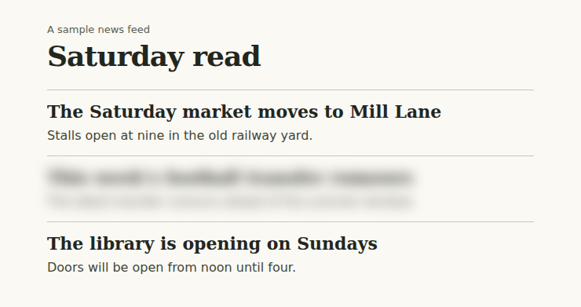

# ClearScroll

ClearScroll is a Chrome extension for blurring text about a topic you’d rather skip. Pick one topic and matching snippets blur as you browse. The extension checks both the words on the page and how closely the text relates to your topic, right in your browser.

The build on `main` still appears as **IdeaBlocker** in Chrome. You can try it by building from source and loading it as an unpacked extension.



*“Transfer rumours” as the block target on a sample page, captured in Chromium. This run used word and phrase matching.*

## Build and load it in Chrome

You’ll need Chrome 113 or later, Node.js 20 or later, Python 3.12, and a current stable Rust toolchain installed through rustup. Install the [wasm-pack CLI](https://github.com/wasm-bindgen/wasm-pack#-prerequisites) before building.

Run these commands from the repository root in Bash.

```sh
npm ci
python3 -m venv .venv
source .venv/bin/activate
python -m pip install torch transformers numpy
python export_weights.py
wasm-pack build --target web --release
npm run build
```

The export script downloads [BERT Tiny](https://huggingface.co/prajjwal1/bert-tiny) and writes `model/weights.bin`. The Rust build embeds those weights in the WASM file. The final build command bundles the extension into `dist/`.

1. Open `chrome://extensions`, turn on **Developer mode**, and choose **Load unpacked**. Select the `dist/` folder.
2. On the IdeaBlocker card, open **Details → Extension options**. Enter one topic in **Block Target**, leave the mode on **Precision**, and click **Save**.
3. Reload the page you want to filter. Try **Balanced** or **Aggressive** if too much relevant text stays visible. Broader modes can blur unrelated text too.

Use **Excluded Sites** to skip a site, or **Protected Selectors** to keep parts of a page visible. Enter one hostname or CSS selector per line. Clear **Block Target** and save to turn off filtering.

## What to expect

Some matches will slip through and unrelated text can get blurred by mistake. Text can also appear before the filter has finished checking it. The original text remains in the page under the blur.

The topic and settings are stored in Chrome’s local extension storage. Chrome asks for access to HTTP and HTTPS pages so the content script can read and blur text. The worker compares text embeddings using Rust, WebAssembly and WebGPU. If the semantic engine fails to start, it falls back to word and phrase matching. That happened in the Chromium run shown above because the worker couldn’t load its WASM module. The [content script](src/extractor.ts) collects page text and applies the blur. The [worker](src/brain.worker.ts) decides what matches.

## Report a problem

If a page blurs the wrong thing, a public URL, the topic and mode you used, and what you expected to stay visible are enough to start. For build trouble, include your OS and the first error from the build. [Open an issue](https://github.com/ozankenangungor/ClearScroll/issues).
