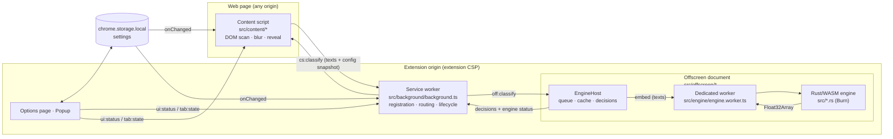
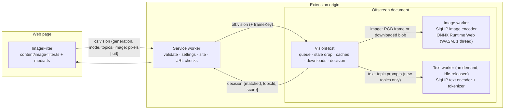

# Architecture

ClearScroll is a Chrome Manifest V3 extension. Text from web pages is
classified by a BERT-family sentence encoder written in Rust, compiled to
WebAssembly and executed in a dedicated Web Worker inside an offscreen
document. Optionally, pictures are classified from their pixels by a second,
independent engine (SigLIP image–text model, ONNX Runtime Web) in the same
offscreen document — see [Image filtering](#image-filtering). Nothing leaves
the device (the one opt-in exception is documented in `docs/PRIVACY.md`).



## Components

| Component | File(s) | Responsibility |
|---|---|---|
| Content script | `src/content/content.ts`, `controller.ts`, `dom.ts`, `content.css` | Finds text units, queues near-viewport units, sends batches, applies verdicts, reveal interaction. Runs in the page's isolated world. |
| Service worker | `src/background/background.ts` | Settings migration; registers the content script only while filtering is active; injects into already-open tabs; owns the offscreen document; routes messages. |
| Offscreen document | `src/offscreen/offscreen.ts`, `engine-host.ts`, `lru.ts` | Hosts the engine worker; FIFO job queue; per-frame stale-job dropping; embedding cache; backend selection, self-test, canary and fail-over; computes decisions. |
| Engine worker | `src/engine/engine.worker.ts` | Owns one WebAssembly instance; loads weights; embeds batches strictly one at a time. |
| Rust engine | `src/weights.rs`, `tokenizer.rs`, `model.rs`, `embedder.rs`, `wasm.rs` | CSWT weight parsing, HF-compatible WordPiece tokenizer, BERT encoder on Burn (WebGPU or ndarray CPU backend), mean pooling + L2 norm. |
| Shared logic | `src/shared/*` | Settings schema/migration, site rules, message protocol + runtime guards, lexical matcher, decision function, calibrated model profiles. |
| UI | `src/options/*`, `src/popup/*`, `src/ui/common.css` | Topics, strictness, site rules, protected selectors, engine preference, image options, diagnostics; per-tab status and quick controls. |
| Image filtering (content) | `src/content/image-filter.ts`, `media.ts` | Media discovery and eligibility, in-page pixel reading, near-viewport scheduling, verdicts, image blur/reveal. |
| Image filtering (offscreen) | `src/offscreen/vision-host.ts`, `src/vision/*`, `src/shared/vision.ts` | Image/text model workers (ONNX Runtime Web), queue, caches, downloads, decision rule. |

## Why an offscreen document

The original design created the worker from the content script. Measured in
Chromium (see `docs/ENGINEERING_DECISIONS.md#1`):

* `new Worker("chrome-extension://…")` from a content script throws
  `SecurityError` (cross-origin);
* the `blob:` fallback inherited the page's origin and CSP: on a page with
  `worker-src 'self'` no worker could start at all, and on other pages the
  WASM module could not be imported (`use_dynamic_url`), so **semantic
  inference never ran**.

The offscreen document runs under the extension's own CSP
(`script-src 'self' 'wasm-unsafe-eval'`), is unaffected by page CSPs, removes
the need for `web_accessible_resources`, and lets every tab share one loaded
model instead of loading it per tab.

## Data flow of one classification

1. The content script groups text into **units** — the nearest non-inline
   ancestor of a text node (`<p>`, `<li>`, a tweet's text `<div>` …), so the
   spans and links inside one paragraph are classified together. Elements that
   contain block children are containers and are never blurred as a whole.
2. Units within ±1.5 viewports (IntersectionObserver; layout geometry in
   background tabs, which do not render) are queued. The first request after
   (re)configuration carries 8 texts so on-screen content is handled quickly;
   later requests carry up to 24. At most 2 requests per frame are in flight.
3. Each request carries an immutable snapshot: `generation`, `mode`, and the
   active topics. The background attaches a `frameKey` (tab, frame, document)
   and forwards it to the offscreen document.
4. `EngineHost` answers a frame's queued jobs `stale` as soon as a newer
   generation arrives for that frame, refuses new jobs with a retryable
   `engine overloaded` error while 256 are already waiting, looks texts and
   topics up in an LRU cache (4,000
   entries), sends only missing ones to the worker, and runs the shared
   `decide()` function. For the shipped model the score is a **margin**:
   cosine similarity to the topic minus the text's best similarity to the
   unrelated ones of 26 background topics (precomputed vectors from
   `model.json`); a text matches if the best topic's score ≥ the model- and
   mode-specific threshold and the text is long enough, otherwise lexical
   rules apply. See `docs/MODEL.md#margin-scoring-against-background-topics`.
5. The content script applies a verdict only if the reply's generation is still
   current, filtering is still active, the element is still connected and its
   text equals the text that was classified. Everything else is dropped and
   changed elements are re-queued. A matched unit is shown hidden through its
   **feed item** when it has one (`itemOf` in `dom.ts`): the nearest ancestor,
   at most 8 levels up, that contains an image or video of at least 64×48 px
   and at most 3 text units of 24+ characters, and is not a landmark or
   protected region — so a video card or news promo is hidden with its
   thumbnail, but never a list or a box of several stories. An item stays
   hidden while any of its texts matches and is revealed as a whole.

## Image filtering

Opt-in (`settings.images`, default off). A second pipeline next to the text
one; it shares the content script's generation, observers, ownership tag and
reveal handling, and the offscreen document, but nothing else.



**1. Discovery and eligibility** (`media.ts`). Candidates: `` (the
`currentSrc` the browser selected, so `<picture>`/`srcset` work), `<video
poster>`, and elements whose content is one CSS background picture (inline
`style` or `role="img"`, no text, no `` inside, not fixed, ≤ 60 % of the
viewport). Required: rendered ≥ 100 × 80 CSS px, aspect ratio ≤ 4.5,
natural size ≥ 48 px, not SVG, not in a protected area (the text list —
navigation, header/footer landmarks, forms, buttons, editable regions, user
selectors — **except `aria-hidden`**: sites mark visible thumbnails
`aria-hidden` when the title link is the accessible copy, e.g. every YouTube
thumbnail). Pictures not laid out yet (0 × 0), hidden, or fully transparent
(lazy layouts and fade-ins) are *pending*: re-checked on `load`,
`transitionend`/`animationend`, intersection, and once a second while any is
waiting near the viewport (≤ 300 per round) — found necessary on YouTube,
where thumbnails load at opacity 0 inside containers laid out later. Image
dimensions only decide *whether* a picture is analysed, never whether it
matches.

**2. Scheduling** (`image-filter.ts`). An IntersectionObserver with a
half-viewport margin (layout geometry in background tabs); the queue
(≤ 200) is served visible-first, nearest-next; at most 2 requests in flight
per frame; one request per picture identity (kind + URL) at a time, and a
verdict of the current generation is reused for every element showing the
same picture. Pending (`complete === false`) images resume on their `load`
event; `src`, `srcset`, `sizes`, `poster` and `style` changes are observed
(attribute observation is enabled only while image filtering is on).

**3. Pixels.** The content script draws the displayed picture (or decodes a
`data:`/`blob:` URL) into a 224 × 224 canvas — the model's input size; SigLIP
resizes the whole picture without cropping — and sends the RGB bytes
(base64, 200 KB; runtime messaging is JSON-only). No network. If the canvas
is tainted (a cross-origin picture without CORS approval) the picture is
skipped as `cross-origin`, unless the user enabled downloads, in which case
its URL is sent instead.

**4. Background checks.** `cs:vision` is validated (`isVisionRequest`:
exact frame length and alphabet, URL length, topics, generation, mode) and
accepted only from content scripts in a tab; image filtering must be on and
the frame's site not excluded; a URL request additionally needs
`imageDownloads` and must pass `checkImageUrl` (public http(s) host, no
credentials, no localhost/private/link-local/special addresses or `.local`
style names).

**5. VisionHost** (`vision-host.ts`). Loads nothing before the first image
request. One job at a time; ≤ 32 waiting (`overloaded` beyond); per frame,
older generations are answered `stale`. Downloads: `credentials: "omit"`,
`referrerPolicy: "no-referrer"`, image MIME types only (no SVG), ≤ 8 MiB
(header and streamed), 10 s timeout, and `redirect: "manual"`: any redirect
answer (a readable 3xx, or the `opaqueredirect` response cross-origin
redirects produce, whose `Location` is not exposed to fetch) fails the
download, so a redirect target — possibly a private address — is never
requested. Validating each hop is impossible with fetch, hence refusal.
The URL check cannot see DNS answers (rebinding is not detected; see
`checkImageUrl`).

*Consent lifecycle.* Every download has an `AbortController`.
`shutdown()` (image filtering off) and `revokeDownloads(revokedAt)` abort
all of them immediately. The service worker stamps each approved URL request
with `downloadGrant` = its latest revocation time, read *before* it checks
the settings; when permission is withdrawn (downloads/images/filtering off,
no active topic, a newly excluded site) it records a new revocation time
(session storage, so it survives a service-worker restart) and sends
`off:vision-revoke-downloads`; VisionHost refuses grants older than the
newest revocation, so a request approved just before the change cannot start
a download after it, whatever the message order. `shutdown()` also starts a
new *epoch*: a job or model initialisation begun earlier re-checks the epoch
after each await and stops — no download, worker start, cache write or
status report after shutdown (pending initialisations are rejected at once
instead of running into their timeout).

*Late requests* (`src/background/vision-gate.ts`). A request can pass the
service worker's settings check and then wait — for the offscreen lock or
document creation, or in message delivery — while the user turns image
filtering off. Whenever image filtering stops being active (Images off,
paused, no active topic) the gate records an images-revocation time
(session storage) and sends `off:vision-shutdown` with it; every request
carries `visionGrant`, the latest such time when it was authorised (read
before the settings check). A revocation overtaking a waiting request ends
it in the gate — checked inside the offscreen lock right before a document
would be created (so a paused session's closed document is not recreated),
after `ensureOffscreen` and before every send — and a request already on
its way is refused by VisionHost because its grant predates the shutdown.
It therefore never loads the model again; requests authorised after
re-enabling work normally. Deterministic ordering tests drive the real gate
and host together: `tests/unit/vision-gate.test.ts`. Revoking downloads leaves the image
model, its caches, pixel-based analysis and the text engine running.
Caches, memory only: image embeddings by identity (`u:<url>` or `p:<sha256
of the RGB frame>`; 1,000 entries; topic-independent, so changing topics
re-scores without inference), topic embeddings by text (64). The background
prompts' embeddings are computed at build time (`scripts/vision-background.ts`,
same runtime and files → `offscreen/vision/background.json`, validated before
use).

**6. Workers** (`src/vision/vision.worker.ts`, one bundle, two roles). The
image worker holds the image encoder for as long as image filtering is on.
The text worker is started only when a topic has no cached embedding, embeds
each prompt on its own (batching would change results: the int8 model
quantises activations per tensor) and is terminated after 20 s without use,
because a WebAssembly heap is only returned when its worker ends. ONNX
Runtime uses one WebAssembly thread: multi-threading needs cross-origin
isolation of the extension pages and crashed the renderer in the bundled
configuration; the GPU is not used (the int8 operators have no WebGPU
kernels and fp16 weights would double the size).

**7. Decision** (`decideImage`, `src/shared/vision.ts`, calibrated in
`docs/evaluation/vision/`): match ⇔ cos(picture, topic) ≥ minSimilarity **and**
cos(picture, topic) − max over 22 generic background descriptions ≥
minMargin (per strictness), background descriptions that are synonyms of the
topic excluded. Topic = mean of 3 prompt embeddings ("a photo of {topic}." …).

**8. Applying verdicts.** Same rules as text: current generation, still
active, still connected, **same picture identity** (a changed source drops
the old verdict and is re-queued). Matched pictures get
`data-clearscroll="blurred"` plus `data-clearscroll-media` (a 28 px blur
clipped to the element). Nesting: a picture inside an item hidden because of
its text is not blurred a second time; revealing the item marks the pictures
inside as revealed; when the item is cleared, pictures fall back to their own
verdicts. A revealed picture stays revealed until its source changes.
Turning images off removes all picture effects (text effects stay), unloads
both workers and clears the caches.

| Image failure | Behaviour | Visible as |
|---|---|---|
| Model fails to load / init timeout (120 s) | pictures left visible; retried after 5 min | state `error`, detail in diagnostics |
| Image worker crash / 30 s inference timeout | worker restarted (≤ 2×), job retried by the content script | then `error` |
| Text worker crash | the job fails (retryable); next topic starts a new worker | — |
| Picture cannot be read (cross-origin, downloads off) | left visible | popup count "from other domains not checked" |
| Download fails, redirect, not an image, too large, decode error, ineligible URL | left visible, not retried for that picture | diagnostics counters |
| Download permission withdrawn / images turned off mid-download | download aborted at once, picture left visible | `downloads-off` / `disabled` |
| Queue full / model loading | retried with backoff (1 s → 60 s, ≤ 5 attempts) | — |

## State and concurrency

* **No shared mutable "current target".** The previous worker kept the target
  embedding and mode as globals updated by separate `SET_TARGET`/`SET_CONFIG`
  messages processed concurrently (`void processRequest(req)`), so a
  comparison could use a half-updated configuration. Now every job is
  self-describing.
* **Serialised execution.** The offscreen queue runs one job at a time and the
  worker chains embeds, so the single WASM instance never interleaves GPU
  readbacks.
* **Serialised lifecycle.** Content-script registration syncs run on a promise
  chain; offscreen create/close/replace run under one lock. Both races were
  reproduced before the fix (see the regression test
  "cold start with concurrent tabs").
* **Generations in the content script.** Any settings change increments the
  generation and rescans; stopping clears every visual change immediately.

## Failure handling

| Failure | Behaviour | Reported state |
|---|---|---|
| No WebGPU adapter, or only a software (SwiftShader) adapter | CPU backend | `semantic` / `cpu`, detail explains why |
| WebGPU init fails or times out (120 s) | worker terminated, CPU backend started | `semantic` / `cpu`, detail lists the error |
| Backend computes wrong numbers | start-up **self-test** (PyTorch reference vectors in `model.json`) and a per-batch **canary** on GPU reject it → next backend | detail: `self-test failed` / `GPU canary mismatch` |
| Runtime failure (device lost, worker crash, embed timeout 60 s) | fail over to the next backend (the last one is restarted up to 2 times) and retry the same job on each backend that comes up, at most 4 attempts; nothing computed by the failed worker is reused | detail lists the failure; the job ends semantic, or lexical together with the engine |
| No backend works / engine set to "keywords only" | lexical rules only | `lexical-fallback` |
| Background/offscreen unreachable | content script uses lexical rules locally | `lexical-fallback` |
| Offscreen queue full (256 waiting jobs) | request refused at once, not queued; units retried with the backoff below | console warning `engine overloaded` |
| Request fails | units retried with exponential backoff (0.5 s → 30 s) | console warning |
| Extension reloaded/removed | content script tears down and removes all blur | — |

## Settings persistence

`chrome.storage.local["clearscroll_settings"]`, schema 2:

```ts
{ schema: 2, enabled: boolean, mode: "precision" | "balanced" | "aggressive",
  engine: "auto" | "cpu" | "off", topics: { id, text, enabled }[],
  excludedSites: string[] /* normalised hosts */, protectedSelectors: string[],
  images: boolean /* default false */, imageDownloads: boolean /* default false */ }
```

The image fields were added without a schema bump: stored settings without
them (all existing users) normalise to `false`, i.e. unchanged text-only
behaviour; only a literal `true` enables either.

Builds published as "IdeaBlocker" stored `ideablocker_settings` (one target
string) or `ideablocker_target`; `migrateSettings()` converts both on install,
update or first read and removes the legacy keys. `normalizeSettings()` treats
storage as untrusted and can never throw.

## Site rules

One policy, implemented once in `src/shared/sites.ts` and used by the content
script, the background (`excludeMatches`) and the UI:

| Input | Stored as | Matches |
|---|---|---|
| `example.com` | `example.com` | `example.com`, `www.example.com`, `a.b.example.com` |
| `*.example.com` | `example.com` | same as above (Chrome match patterns cannot express "subdomains only") |
| `https://Example.com:8080/path` | `example.com` | scheme, port and path are ignored |
| `bücher.de` | `xn--bcher-kva.de` | IDNA via the WHATWG URL parser, exactly as the browser |
| `localhost`, `127.0.0.1` | as is | exact host only |
| `*foo.com`, `a.*.com`, `com`, `[::1]` | — | rejected with a message |
| duplicates (after normalisation) | once | — |

`badexample.com` never matches `example.com` (label boundary). A unit test
checks that the content-script matcher and the generated Chrome
`excludeMatches` agree on a set of hosts. Limitation: multi-label public
suffixes (`co.uk`) are accepted because no public-suffix list is bundled.

## Rust/WASM boundary

```text
init_engine(weights: Uint8Array, vocab: string, backend: "webgpu" | "cpu") -> dim
embed_batch(texts: string[]) -> Float32Array   // texts.len() × dim, L2-normalised
```

JS owns artifact loading and backend choice; Rust owns all numerics. The
wgpu runtime aborts the instance when no adapter exists, so the offscreen
document probes `navigator.gpu.requestAdapter({ powerPreference:
"high-performance" })` (the preference cubecl-wgpu uses) before asking for
WebGPU, and a failed backend is abandoned by terminating its worker.

Inside the engine, texts are tokenised, **sorted by length** and run in
chunks (8 on CPU, 32 on GPU) padded to the chunk's longest sequence, then
scattered back to input order.

## Keyboard and focus

Blurred units get `tabindex="0"` (only if not focusable already) and a
`title` hint; Enter, Space or a click reveals them. On reveal the added
tabindex becomes `-1` in place, so focus stays on the item instead of jumping
to `<body>`; it returns to `0` if the item is blurred again and is removed
once the item is cleared and focus has left it. Everything ClearScroll adds
is marked with `data-clearscroll-*` attributes and owned by one content-script
instance (`data-clearscroll-owner`), so an orphaned instance after an
extension update cannot remove another instance's state.

## Supported browsers

Chrome ≥ 116 (offscreen documents, `runtime.getContexts`). The test suites run
on Playwright's Chromium and on branded Google Chrome stable; the latter
loads unpacked extensions only via DevTools `Extensions.loadUnpacked` (the
`--load-extension` flag is ignored since Chrome 137), which the test helper
handles.

## Limitations (by design or not yet addressed)

* **Shadow DOM**: text inside shadow roots is not analysed (document-level
  observers and stylesheets do not reach into them).
* **iframes**: the content script runs in top-level frames only
  (`allFrames: false`); cross-origin iframes would need their own injection
  and same-origin iframes are not handled yet.
* **Existing `filter` styles**: while an element is blurred, ClearScroll's
  `filter: blur()` replaces the page's own `filter` on that element; it is
  restored exactly when the blur is removed.
* **Flash of content**: content is visible until its verdict arrives (≈ 0.1 s
  warm, 0.7–1.1 s for the first page after the engine starts on CPU, see
  `docs/BENCHMARKS.md`).
* **Languages**: the shipped encoders are English-only (see `docs/MODEL.md`).
* **Pictures**: see the image-filtering limitations in the README — coverage
  (no iframes, shadow roots, canvas, video frames; other-domain pictures only
  with downloads), ≈ 0.6 s per new picture on one CPU thread, pictures visible
  until analysed.
