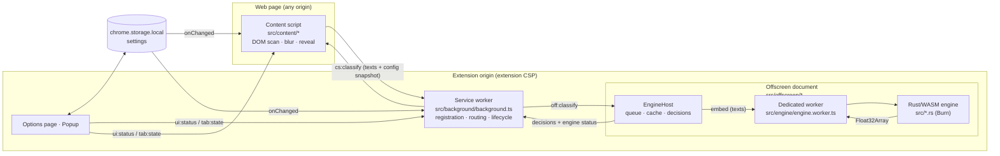

# Architecture

ClearScroll is a Chrome Manifest V3 extension. Text from web pages is
classified by a BERT-family sentence encoder written in Rust, compiled to
WebAssembly and executed in a dedicated Web Worker inside an offscreen
document. Nothing leaves the device.



## Components

| Component | File(s) | Responsibility |
|---|---|---|
| Content script | `src/content/content.ts`, `controller.ts`, `dom.ts`, `content.css` | Finds text units, queues near-viewport units, sends batches, applies verdicts, reveal interaction. Runs in the page's isolated world. |
| Service worker | `src/background/background.ts` | Settings migration; registers the content script only while filtering is active; injects into already-open tabs; owns the offscreen document; routes messages. |
| Offscreen document | `src/offscreen/offscreen.ts`, `engine-host.ts`, `lru.ts` | Hosts the engine worker; FIFO job queue; per-frame stale-job dropping; embedding cache; backend selection, self-test, canary and fail-over; computes decisions. |
| Engine worker | `src/engine/engine.worker.ts` | Owns one WebAssembly instance; loads weights; embeds batches strictly one at a time. |
| Rust engine | `src/weights.rs`, `tokenizer.rs`, `model.rs`, `embedder.rs`, `wasm.rs` | CSWT weight parsing, HF-compatible WordPiece tokenizer, BERT encoder on Burn (WebGPU or ndarray CPU backend), mean pooling + L2 norm. |
| Shared logic | `src/shared/*` | Settings schema/migration, site rules, message protocol + runtime guards, lexical matcher, decision function, calibrated model profiles. |
| UI | `src/options/*`, `src/popup/*`, `src/ui/common.css` | Topics, strictness, site rules, protected selectors, engine preference, diagnostics; per-tab status and quick controls. |

## Why an offscreen document

The original design created the worker from the content script. Measured in
Chromium (see `docs/ENGINEERING_DECISIONS.md#1`):

* `new Worker("chrome-extension://…")` from a content script throws
  `SecurityError` (cross-origin);
* the `blob:` fallback inherited the page's origin and CSP: on a page with
  `worker-src 'self'` no worker could start at all, and on other pages the
  WASM module could not be imported (`use_dynamic_url`), so **semantic
  inference never ran**.

The offscreen document runs under the extension's own CSP
(`script-src 'self' 'wasm-unsafe-eval'`), is unaffected by page CSPs, removes
the need for `web_accessible_resources`, and lets every tab share one loaded
model instead of loading it per tab.

## Data flow of one classification

1. The content script groups text into **units** — the nearest non-inline
   ancestor of a text node (`<p>`, `<li>`, a tweet's text `<div>` …), so the
   spans and links inside one paragraph are classified together. Elements that
   contain block children are containers and are never blurred as a whole.
2. Units within ±1.5 viewports (IntersectionObserver; layout geometry in
   background tabs, which do not render) are queued. The first request after
   (re)configuration carries 8 texts so on-screen content is handled quickly;
   later requests carry up to 24. At most 2 requests per frame are in flight.
3. Each request carries an immutable snapshot: `generation`, `mode`, and the
   active topics. The background attaches a `frameKey` (tab, frame, document)
   and forwards it to the offscreen document.
4. `EngineHost` drops queued jobs whose generation is older than the newest
   seen for that frame, looks texts and topics up in an LRU cache (4,000
   entries), sends only missing ones to the worker, and runs the shared
   `decide()` function: best cosine similarity across topics ≥ the
   model- and mode-specific threshold (and text ≥ a minimum length), otherwise
   lexical rules.
5. The content script applies a verdict only if the reply's generation is still
   current, filtering is still active, the element is still connected and its
   text equals the text that was classified. Everything else is dropped and
   changed elements are re-queued.

## State and concurrency

* **No shared mutable "current target".** The previous worker kept the target
  embedding and mode as globals updated by separate `SET_TARGET`/`SET_CONFIG`
  messages processed concurrently (`void processRequest(req)`), so a
  comparison could use a half-updated configuration. Now every job is
  self-describing.
* **Serialised execution.** The offscreen queue runs one job at a time and the
  worker chains embeds, so the single WASM instance never interleaves GPU
  readbacks.
* **Serialised lifecycle.** Content-script registration syncs run on a promise
  chain; offscreen create/close/replace run under one lock. Both races were
  reproduced before the fix (see the regression test
  "cold start with concurrent tabs").
* **Generations in the content script.** Any settings change increments the
  generation and rescans; stopping clears every visual change immediately.

## Failure handling

| Failure | Behaviour | Reported state |
|---|---|---|
| No WebGPU adapter, or only a software (SwiftShader) adapter | CPU backend | `semantic` / `cpu`, detail explains why |
| WebGPU init fails or times out (120 s) | worker terminated, CPU backend started | `semantic` / `cpu`, detail lists the error |
| Backend computes wrong numbers | start-up **self-test** (PyTorch reference vectors in `model.json`) and a per-batch **canary** on GPU reject it → next backend | detail: `self-test failed` / `GPU canary mismatch` |
| Runtime failure (device lost, worker crash, embed timeout 60 s) | fail over to the next backend and retry the job once | detail lists the failure |
| No backend works / engine set to "keywords only" | lexical rules only | `lexical-fallback` |
| Background/offscreen unreachable | content script uses lexical rules locally | `lexical-fallback` |
| Request fails | units retried with exponential backoff (0.5 s → 30 s) | console warning |
| Extension reloaded/removed | content script tears down and removes all blur | — |

## Settings persistence

`chrome.storage.local["clearscroll_settings"]`, schema 2:

```ts
{ schema: 2, enabled: boolean, mode: "precision" | "balanced" | "aggressive",
  engine: "auto" | "cpu" | "off", topics: { id, text, enabled }[],
  excludedSites: string[] /* normalised hosts */, protectedSelectors: string[] }
```

Builds published as "IdeaBlocker" stored `ideablocker_settings` (one target
string) or `ideablocker_target`; `migrateSettings()` converts both on install,
update or first read and removes the legacy keys. `normalizeSettings()` treats
storage as untrusted and can never throw.

## Site rules

One policy, implemented once in `src/shared/sites.ts` and used by the content
script, the background (`excludeMatches`) and the UI:

| Input | Stored as | Matches |
|---|---|---|
| `example.com` | `example.com` | `example.com`, `www.example.com`, `a.b.example.com` |
| `*.example.com` | `example.com` | same as above (Chrome match patterns cannot express "subdomains only") |
| `https://Example.com:8080/path` | `example.com` | scheme, port and path are ignored |
| `bücher.de` | `xn--bcher-kva.de` | IDNA via the WHATWG URL parser, exactly as the browser |
| `localhost`, `127.0.0.1` | as is | exact host only |
| `*foo.com`, `a.*.com`, `com`, `[::1]` | — | rejected with a message |
| duplicates (after normalisation) | once | — |

`badexample.com` never matches `example.com` (label boundary). A unit test
checks that the content-script matcher and the generated Chrome
`excludeMatches` agree on a set of hosts. Limitation: multi-label public
suffixes (`co.uk`) are accepted because no public-suffix list is bundled.

## Rust/WASM boundary

```text
init_engine(weights: Uint8Array, vocab: string, backend: "webgpu" | "cpu") -> dim
embed_batch(texts: string[]) -> Float32Array   // texts.len() × dim, L2-normalised
```

JS owns artifact loading and backend choice; Rust owns all numerics. The
wgpu runtime aborts the instance when no adapter exists, so the offscreen
document probes `navigator.gpu.requestAdapter({ powerPreference:
"high-performance" })` (the preference cubecl-wgpu uses) before asking for
WebGPU, and a failed backend is abandoned by terminating its worker.

Inside the engine, texts are tokenised, **sorted by length** and run in
chunks (8 on CPU, 32 on GPU) padded to the chunk's longest sequence, then
scattered back to input order.

## Limitations (by design or not yet addressed)

* **Shadow DOM**: text inside shadow roots is not analysed (document-level
  observers and stylesheets do not reach into them).
* **iframes**: the content script runs in top-level frames only
  (`allFrames: false`); cross-origin iframes would need their own injection
  and same-origin iframes are not handled yet.
* **Existing `filter` styles**: while an element is blurred, ClearScroll's
  `filter: blur()` replaces the page's own `filter` on that element; it is
  restored exactly when the blur is removed.
* **Flash of content**: content is visible until its verdict arrives (≈ 0.1 s
  warm, 0.7–1.1 s for the first page after the engine starts on CPU, see
  `docs/BENCHMARKS.md`).
* **Languages**: the shipped encoders are English-only (see `docs/MODEL.md`).
